# Installare il gestionale in negozio

Guida per chi installa: server, PC dell'ufficio, casse, operatori. Si fa una volta, in quest'ordine.
Le immagini vengono da una **simulazione automatica** dell'installazione completa
(`tests/test_simulazione_installazione.cpp`): a ogni versione si rifà, e se un passo cambia la
simulazione se ne accorge. I nomi e i dati delle immagini sono di prova.

| Cosa serve | Dove |
|---|---|
| PC del server, acceso negli orari del negozio, nella rete del negozio | ufficio o retro |
| PC dell'ufficio con la **gestione** (`mdr-gestione`) | anche lo stesso PC del server |
| Un PC per cassa con la **cassa** (`mdr-cassa`) e il registratore Custom in rete | banco |
| Pacchetto di installazione dei programmi (`Installa.bat`) | chiavetta o download |
| Per ogni registratore: **indirizzo IP fisso** e servizio Web/XML attivo | dal tecnico del registratore |

Non servono chiavi da copiare, token o email vere: il server si trova da solo nella rete e gli
account sono nomi brevi (`mario`, `cassa2`).

---

## 1. Il server (una volta)

Sul PC del server, come da [infra/windows/README.md](../infra/windows/README.md):

1. Installare **PostgreSQL** (installatore ufficiale, versione 16 o 17) e annotare la password di `postgres`.
2. Collegare il **disco per la seconda copia dei backup** (disco esterno o NAS).
3. Da **PowerShell come amministratore**, nella cartella del progetto:

   ```powershell
   .\infra\windows\installa_server.ps1 -BackupCopia E:\BackupNegozio -Amministratore negozio@negozio.lan
   ```

   Chiede la password di `postgres` e quella dell'amministratore, poi installa e avvia tutto
   (servizi, backup, firewall). L'amministratore entra poi in gestione col nome **`negozio`**.

Il server deve restare acceso mentre si installano gli altri PC: è lui che si fa trovare.

## 2. La gestione sul PC dell'ufficio

Eseguire `Installa.bat` e aprire **Mondo del Risparmio — Gestione**. Al primo avvio parte la
prima installazione guidata.

| | |
|---|---|
| 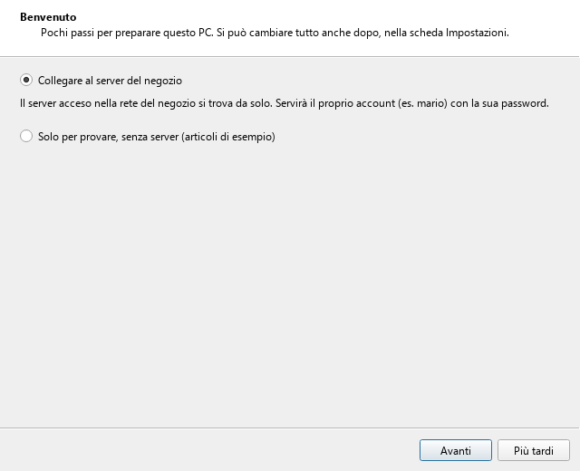 | **Benvenuto**: lasciare *Collegare al server del negozio* e premere *Avanti*. |
| 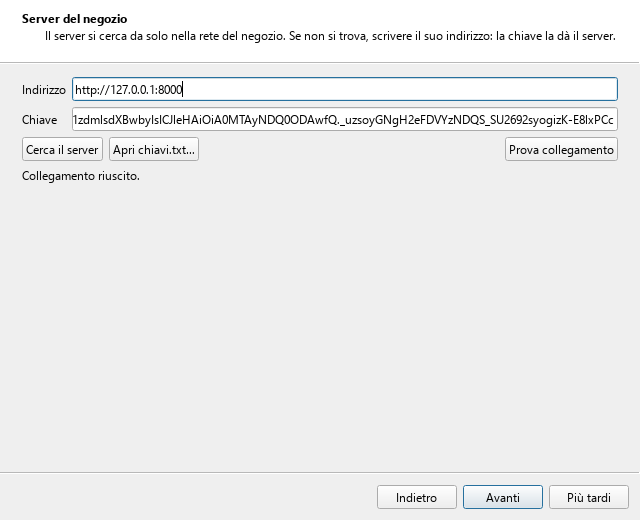 | **Server del negozio**: si cerca da solo; quando compare *Collegamento riuscito* premere *Avanti*. Se dice *Nessun server trovato*: il server è acceso? Il PC è nella rete del negozio? In alternativa scrivere l'indirizzo del server (es. `192.168.1.10`) e *Prova collegamento*. |
| 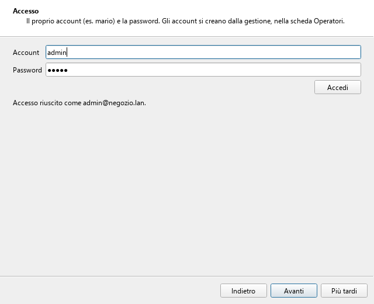 | **Accesso**: account dell'amministratore (`negozio`) e la sua password, *Accedi*, poi *Avanti*. |
| 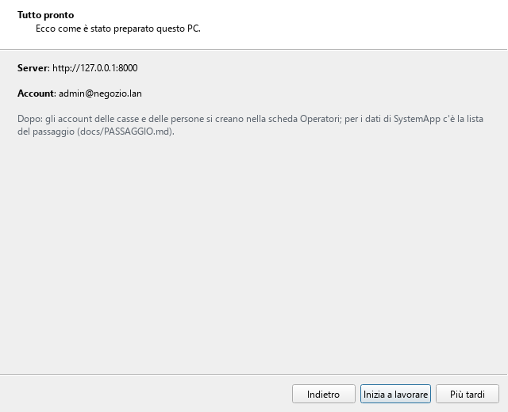 | **Fine**: *Inizia a lavorare*. |

## 3. Operatori e casse (dalla gestione)

Scheda **Operatori**. In alto le persone, in basso le casse.

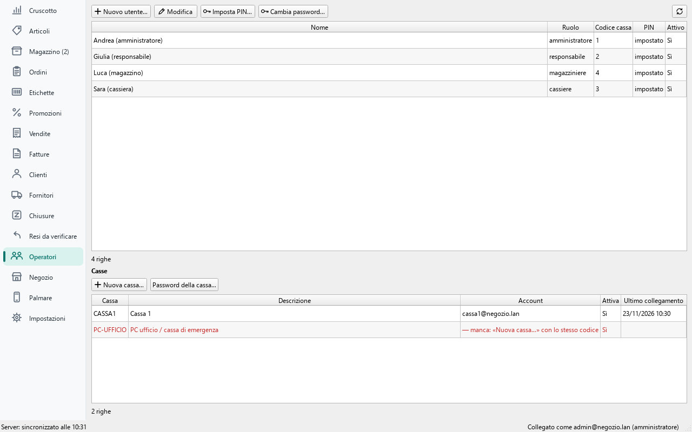

### Una persona per ogni operatore

*Nuovo utente…* per ognuno: chi va in cassa, chi usa la gestione o il palmare.

| | |
|---|---|
| 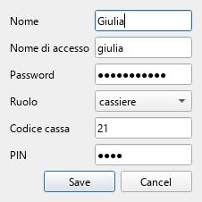 | **Nome** come comparirà sugli scontrini; **Nome di accesso** breve (`giulia`): serve per gestione e palmare; **Password** almeno 6 caratteri; **Ruolo** (cassiere, magazziniere, responsabile, amministratore); per chi va in cassa **Codice cassa** (es. `21`) e **PIN** (4-8 cifre). |
| 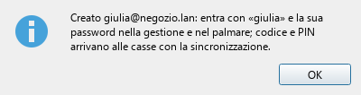 | Conferma: codice e PIN arrivano alle casse da soli. |

Ruoli: **cassiere** solo cassa; **magazziniere** magazzino, ordini e articoli; **responsabile**
tutta la gestione; **amministratore** anche utenti e casse.

### Una cassa per ogni PC del banco

*Nuova cassa…* per ogni PC con la cassa, **prima** di installarlo.

| | |
|---|---|
| 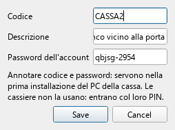 | Il **codice** è proposto (`CASSA2`, `CASSA3`…), la **password** è già pronta. La descrizione è facoltativa. *Save*. |
| 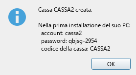 | **Annotare account, password e codice**: servono una volta sola, al passo 4 sul PC della cassa. Le cassiere non li usano mai: entrano col PIN. |
| 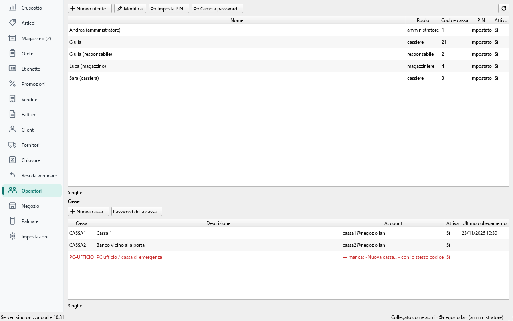 | La cassa compare nell'elenco con il suo account. Una riga **rossa** è una cassa senza account: rifare *Nuova cassa…* con lo stesso codice. |

Password della cassa persa o PC della cassa sostituito: scegliere la cassa e *Password della cassa…*.

## 4. La cassa sul suo PC

Prima: registratore acceso, in **addestramento** per le prove (lo imposta il tecnico).
Eseguire `Installa.bat` e aprire **Mondo del Risparmio — Cassa**.

| | |
|---|---|
| 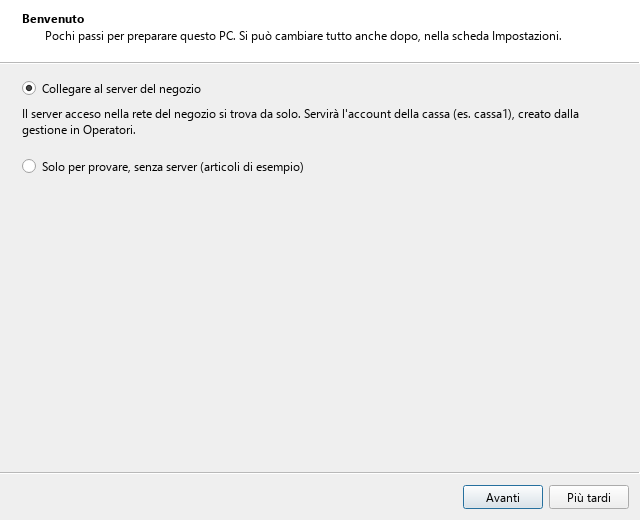 | *Collegare al server del negozio*, *Avanti*. |
|  | Il server si trova da solo, *Avanti*. |
| 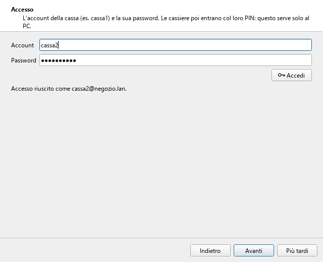 | **Account della cassa** annotato al passo 3 (`cassa2`) e la sua password, *Accedi*, *Avanti*. |
| 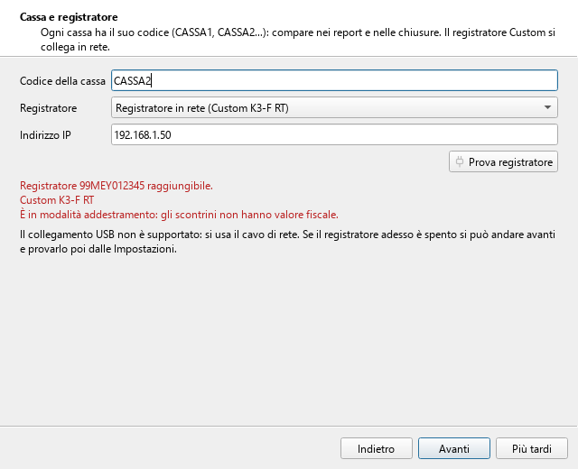 | **Codice della cassa** (`CASSA2`, lo stesso del passo 3); **Registratore in rete** con il suo indirizzo IP; *Prova registratore*: deve comparire la matricola. Se dice *addestramento*, va bene per le prove: prima di vendere davvero il tecnico lo toglie. |
| 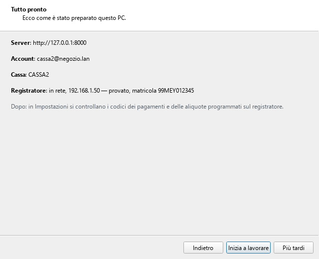 | Riepilogo, *Inizia a lavorare*. |

## 5. Prova di vendita

| | |
|---|---|
| 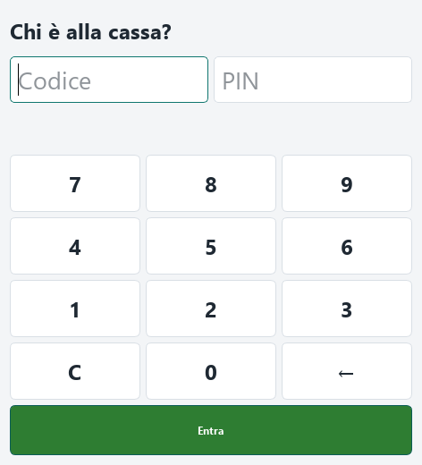 | Al primo articolo la cassa chiede **codice e PIN** della cassiera (quelli del passo 3). |
| 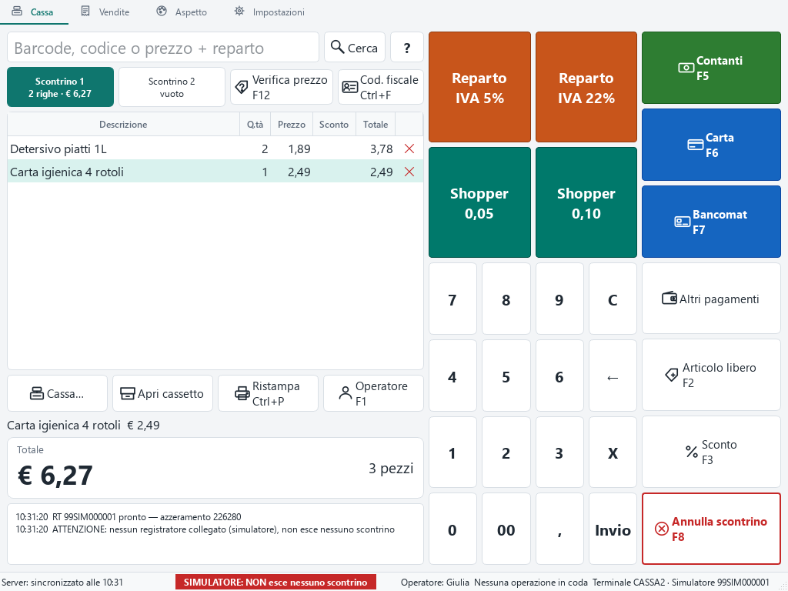 | Passare qualche articolo (o prezzo + reparto). |
| 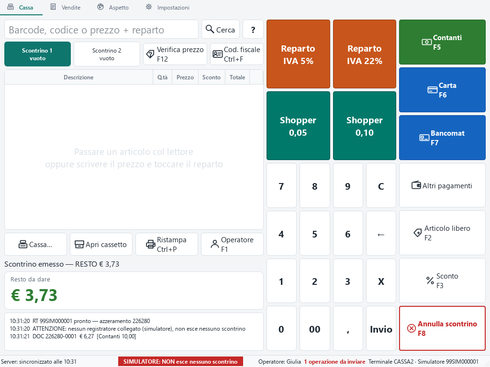 | *Contanti*, importo ricevuto: scontrino emesso, il **resto** compare in grande e il cassetto si apre. In basso: operatore, operazioni da inviare (vanno a zero da sole), terminale e registratore. |

In gestione, scheda Operatori, la cassa risulta collegata (*Ultimo collegamento*):

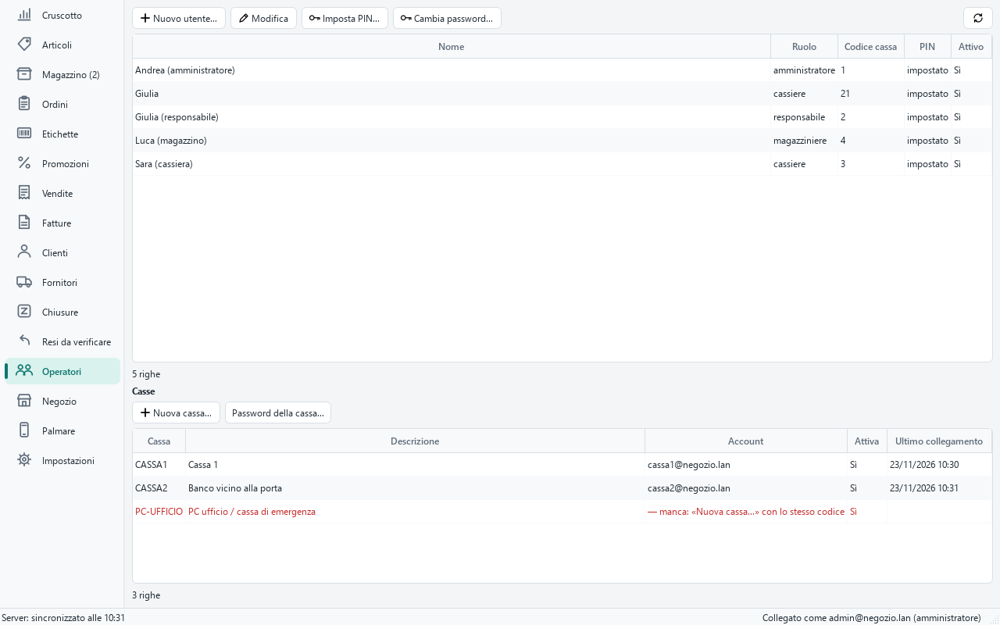

Poi, sempre in addestramento: una vendita con carta, uno sconto, un reso, un annullo e una
**chiusura Z** (vedi la lista completa in [PASSAGGIO.md](PASSAGGIO.md)).

## 6. Palmari

Scheda **Palmare** della gestione: installare l'APK e leggere il **QR** con il palmare (server e
chiave in un colpo solo), poi ognuno entra col suo nome breve (`giulia`). Gli aggiornamenti del
palmare arrivano da soli; Android chiede solo di confermare l'installazione di una versione nuova.

---

## Se qualcosa non va

| Cosa si vede | Cosa fare |
|---|---|
| *Nessun server trovato* | Server acceso? PC nella stessa rete (stesso Wi-Fi o cavo del negozio)? Scrivere l'indirizzo del server e *Prova collegamento*. Ultima strada: *Apri chiavi.txt…* (`config\chiavi.txt` sul server). |
| *Accesso non riuscito* | Nome e password come creati in Operatori. Per una cassa: l'account è `cassa2`, non il nome della cassiera. |
| *Il registratore non risponde* | Indirizzo IP del registratore (menu Rete del registratore), cavo di rete, servizio Web/XML attivo. |
| In cassa **SIMULATORE: NON esce nessuno scontrino** | La cassa non ha il registratore: Impostazioni → registratore in rete con l'indirizzo, poi riavviare. |
| Riga rossa nelle Casse | Cassa senza account: *Nuova cassa…* con lo stesso codice. |

Per rifare la prima installazione su un PC: avviare il programma con `--prima-installazione`.

## Per chi sviluppa: rifare la simulazione

```powershell
.\strumenti\server-sviluppo\avvia.ps1 -Nuovo -Sfondo      # database nuovo: la simulazione crea giulia e CASSA2
$env:MDR_SERVER_SVILUPPO = "http://127.0.0.1:8000"
$env:MDR_CHIAVE_SVILUPPO = "<chiave stampata da avvia.ps1>"
$env:MDR_SCREENSHOT = "$PWD\docs\immagini\installazione"
$env:QT_QPA_PLATFORM = "offscreen"; $env:QT_QPA_FONTDIR = "C:\Windows\Fonts"   # senza finestre a schermo
.\build\debug\bin\test_simulazione_installazione.exe
```
